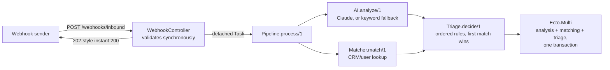

# SupportDesk

A support-ticket pipeline: a webhook receives a message, saves it, runs
it through analyze -> match -> triage, and saves the results back onto
the same row, routing it to the right queue and priority automatically.
Read/write ticket dashboard included. Built for engineering hiring
managers reviewing backend and data-correctness skills.

[](https://github.com/Nabeel-Siddiqui/support-desk/actions)

**Runs locally in under 5 minutes.** See
[Running it locally](#running-it-locally).

## What it does

- A webhook (`POST /webhooks/inbound`) receives a message (`from`,
  `subject`, `text`/`html`, `message_id`), validates it synchronously,
  and answers in milliseconds — the actual processing happens in the
  background, not on the sender's connection.
- Each ticket is analyzed (intent, sentiment, urgency, a one-line
  summary) by Claude, or by deterministic keyword matching when AI is
  disabled or unavailable — the same path this app's tests always run.
- An ordered set of routing rules decides what happens next: spam gets
  auto-resolved, an unhappy high-value customer or anything critical
  gets escalated, billing-related tickets go to the billing queue,
  confident self-serve answers get auto-resolved, everything else goes
  to a general queue. The first matching rule wins.
- All three results (analysis, matching, triage) land in one atomic
  transaction — a ticket is never left half-analyzed.
- A read/write ticket dashboard (LiveView) behind HTTP Basic Auth —
  this is an internal tool, not a public app.

## Why Elixir for this, specifically

A webhook receiver has to answer its sender fast and reliably even
when the slow part of the work (an AI call, a few writes) takes
seconds — and OTP's separation between "answer the request" and "do
the work" is exactly that shape.

- **The AI call happens before any database transaction opens, never
  inside one.** A slow or hanging external call holding a connection
  checked out from the pool is how one degraded dependency exhausts
  capacity for every other request.
  [ADR 1](docs/decisions/0001-ai-call-outside-the-transaction.md)
- **The webhook validates synchronously, then processes fire-and-forget.**
  A malformed payload gets a real 422 the sender's own retry logic can
  act on; a valid one gets accepted instantly while the actual pipeline
  runs in a detached task.
  [ADR 2](docs/decisions/0002-fire-and-forget-not-a-retry-queue.md)
- **The deterministic keyword fallback is the default, not a degraded
  mode.** It's the path every test — and every fresh clone with no API
  key — actually exercises, so it's held to the same bar as the real AI
  call, not treated as an afterthought.
  [ADR 3](docs/decisions/0003-ai-fallback-is-the-default.md)

## Architecture

The path from a received webhook to a routed ticket:



If the pipeline raises anywhere after the ticket is saved, `Pipeline.process/1`
catches it, logs the exception, and marks the ticket `:failed` instead of
crashing — see `lib/support_desk/tickets/pipeline.ex` for the full design
notes on transaction boundaries and failure modes.

## Tech stack

Phoenix 1.7 + LiveView · Ecto/Postgres · Req (Claude API client) ·
Credo (`--strict`) + Dialyzer in CI · GitHub Actions.

## Running it locally

Prerequisites: Elixir and OTP (see [`.github/workflows/ci.yml`](.github/workflows/ci.yml)
for the versions this is tested against) and a local Postgres.

```bash
git clone https://github.com/Nabeel-Siddiqui/support-desk.git
cd support-desk
mix setup        # deps, DB create + migrate, assets
mix phx.server
```

Visit `http://localhost:4000` — dev credentials are `admin` / `admin`
(see `config/dev.exs`). The whole browser UI sits behind HTTP Basic
Auth; there's no per-user accounts system — swap in `mix phx.gen.auth`
if you need individual attribution later.

To check the whole thing end to end:

```bash
mix test                # 63 tests, no real network calls
mix credo --strict
mix dialyzer
```

## Configuration

| Env var | Required in | Purpose |
|---|---|---|
| `WEBHOOK_SECRET` | prod | Shared secret the inbound webhook must send as `x-webhook-secret`. Dev/test have hardcoded defaults (see `config/dev.exs` / `config/test.exs`). |
| `ADMIN_USERNAME` / `ADMIN_PASSWORD` | prod | Basic Auth credentials gating the ticket UI. |
| `AI_ENABLED` | optional | Set to `true`/`1` to call Claude for ticket analysis. Unset (default) runs the deterministic keyword fallback — no API key needed, works offline and in tests. |
| `ANTHROPIC_API_KEY` | if `AI_ENABLED` | Required once AI is turned on; boot fails fast if it's missing while `AI_ENABLED` is set. |

Two more things are wired via application config, not env vars, since
they're functions/data rather than secrets:

```elixir
# Optional: look up the sender against your own user table. Skipped
# entirely if unset (no compile-time dependency on your Accounts context).
config :support_desk, :user_lookup, &MyApp.Accounts.get_user_by_email/1

# Optional: CRM accounts by sender email domain.
config :support_desk, :crm_accounts, %{
  "acme.com" => %{name: "Acme Corp", tier: "enterprise", owner: "jane@yourcompany.com"}
}
```

## Design decisions

Three of the less-obvious calls are written up in
[`docs/decisions/`](docs/decisions/), each with the alternative
considered and why it lost:

1. [The AI call happens before the transaction, never inside it](docs/decisions/0001-ai-call-outside-the-transaction.md)
2. [The webhook validates synchronously, then processes fire-and-forget](docs/decisions/0002-fire-and-forget-not-a-retry-queue.md)
3. [The deterministic keyword fallback is the default, not a degraded mode](docs/decisions/0003-ai-fallback-is-the-default.md)

`CLAUDE.md` in the repo root has the conventions this app holds to
(contexts own all business logic, the web layer never touches `Repo`
directly, every public context function has `@doc` + `@spec`, no test
ever makes a real network call).

## What I'd do next

- **Oban instead of a bare `Task` for pipeline processing.** The
  webhook's fire-and-forget `Task` (see
  [ADR 2](docs/decisions/0002-fire-and-forget-not-a-retry-queue.md))
  has no retry: a crash mid-pipeline after the ticket is saved is lost,
  not requeued. This is the single highest-value next step.
- **Rule precedence as data, not code order.** `Triage.decide/1`'s
  rules are an ordered list of functions — readable at this size, but
  explicit priorities (like the "rule precedence" idea in Tally's own
  roadmap) would scale better as the rule count grows.
- **Per-user accounts for the ticket dashboard.** Basic Auth is
  deliberately simple for a single-admin internal tool; real per-user
  attribution (who resolved what) would need `mix phx.gen.auth`.
- **A real multi-node run.** The detached `Task` and the pipeline don't
  share any node-local state, so they should already work across
  multiple nodes — but, like the rest of this series, that's only ever
  actually run as one node so far.
